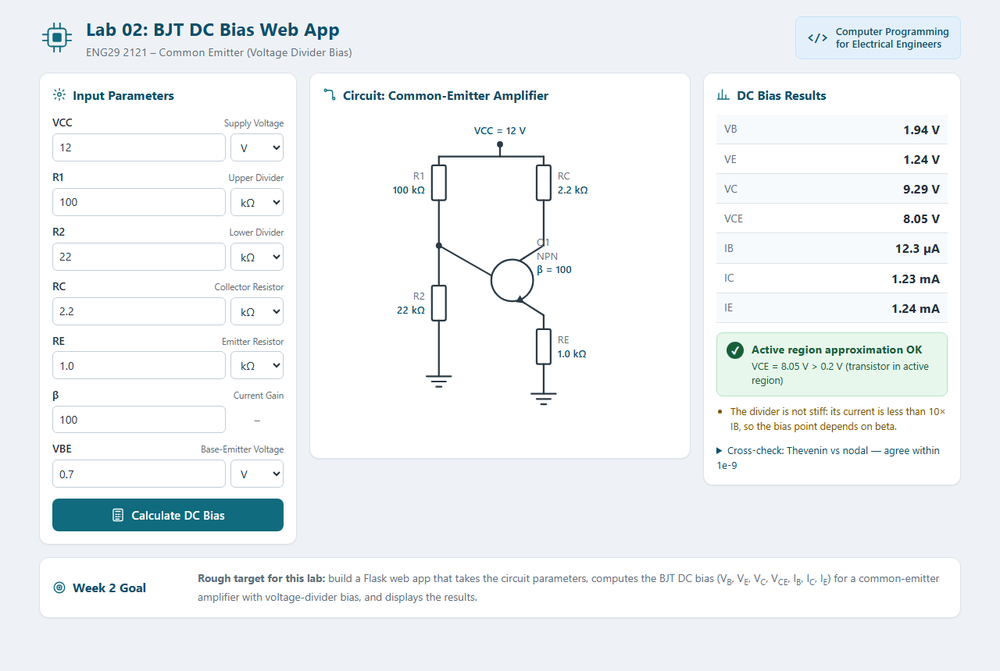
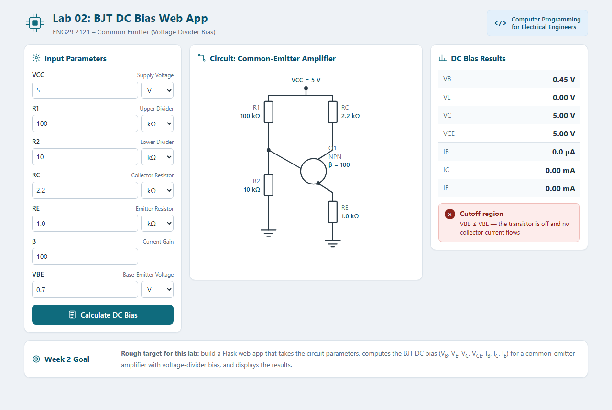
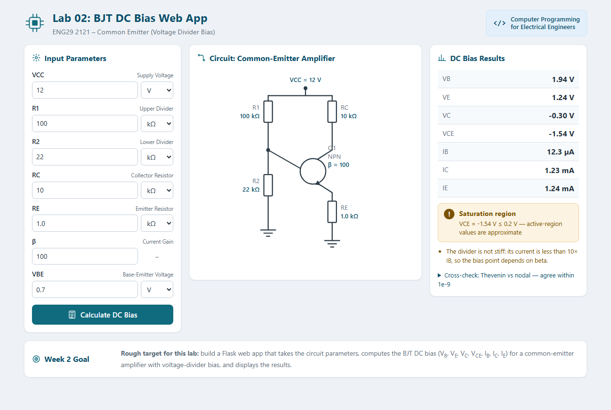
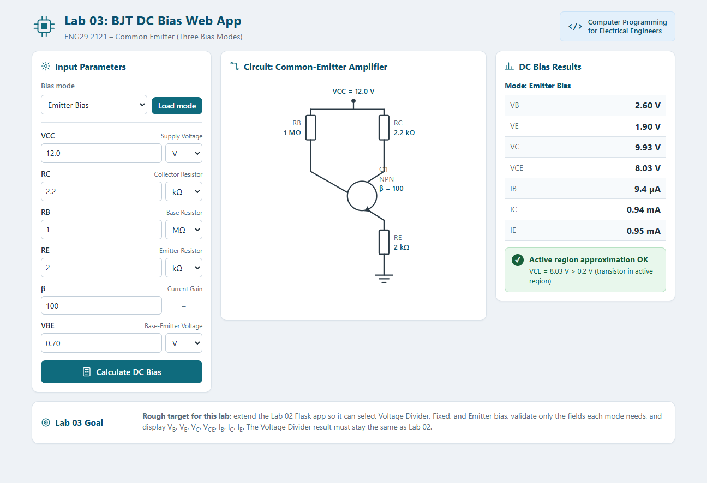
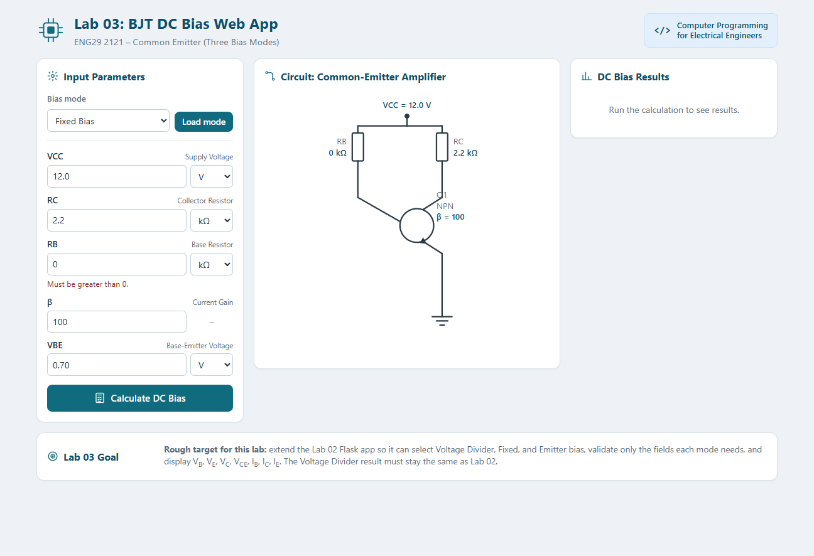

# gitlab

ใช้สำหรับเรียนแลปคอมโปรไฟฟ้า

## DC Circuit Calculator

คำอธิบายและวัตถุประสงค์: โปรแกรมหรือเครื่องมือคำนวณค่าทางไฟฟ้าในวงจรตัวต้านทานแบบอนุกรม ขนาน และผสม มีเป้าหมายเพื่อช่วยคำนวณหาค่ากระแส แรงดัน และกำลังไฟฟ้าได้อย่างแม่นยำ พร้อมอำนวยความสะดวกในการตรวจคำตอบทางทฤษฎี

## BJT Common-Emitter DC Bias (ENG29 2121)

เว็บแอป Flask สำหรับคำนวณจุดทำงาน DC ของวงจรไบอัส Common-Emitter
กรอกค่าองค์ประกอบวงจรแล้วได้ `VB, VE, VC, VCE, IB, IC, IE` พร้อมหน่วย
(IB เป็น µA, IC/IE เป็น mA)

หน้าจอเป็น HTML ล้วน (server-rendered ไม่มี JavaScript) — ช่องกรอกมีตัวเลือกหน่วย
(V/mV และ Ω/kΩ/MΩ) และทุกโหมดมี schematic วงจรของตัวเองเป็น inline SVG
พร้อมค่าที่กรอก

### Lab 02 — Voltage Divider Bias

ผลลัพธ์ของโหมด voltage divider คำนวณสองวิธีอิสระต่อกัน — Thevenin equivalent
และ nodal analysis — แล้วแสดงเทียบกันพร้อมผลต่าง และเตือนเมื่อวงจรอยู่ในโหมด
cutoff หรือ saturation รวมถึงเตือนเมื่อตัวแบ่งแรงดันไม่แข็ง
(กระแสในตัวแบ่งน้อยกว่า 10 เท่าของ IB)

**โหมดนี้คงผลเดิมจาก Lab 02 ทุกค่า** (ตรวจซ้ำใน A1 ของ Lab 03)

### Lab 03 — Three Bias Modes

เพิ่มการเลือกโหมดไบอัสจากหน้าเว็บ ฟอร์มจะแสดงเฉพาะช่องที่โหมดนั้นใช้จริง

| โหมด | ค่าที่ต้องกรอก | สมการหลัก |
|---|---|---|
| `Voltage Divider Bias` | VCC, R1, R2, RC, RE, β, VBE | `IB = (VTH − VBE) / [RTH + (β+1)RE]` |
| `Fixed Bias` | VCC, RC, RB, β, VBE | `IB = (VCC − VBE) / RB` |
| `Emitter Bias` | VCC, RC, RB, RE, β, VBE | `IB = (VCC − VBE) / [RB + (β+1)RE]` |

จากนั้นทุกโหมดใช้ `IC = βIB`, `IE = (β+1)IB`, `VE = IE·RE` (Fixed: `VE = 0`),
`VB = VE + VBE`, `VC = VCC − IC·RC`, `VCE = VC − VE`

- เปลี่ยนโหมดแล้วโหลดฟอร์มใหม่ผ่าน server (`GET /?mode=fixed`) — ไม่ใช้ JavaScript
- แต่ละโหมดมี schematic ของตัวเอง (divider / fixed / emitter) แสดงค่าที่กรอกอยู่บนรูป
- validation ตรวจเฉพาะช่องของโหมดนั้น และแจ้ง error ใต้ช่องที่ผิด
- โหมดที่ไม่รู้จักจะขึ้น error ไม่ถูกตีความเป็น voltage divider เงียบ ๆ
- ถ้า `IB ≤ 0` หรือ `VCE < 0.2 V` จะเตือนว่าแบบจำลอง Forward Active อาจใช้ไม่ได้
  ค่าที่เห็นมาจากสมการ active region และเป็นเพียงค่าประมาณ

### ตัวอย่างหน้าจอ

**Active region** — VCC 12 V, R1 100 kΩ, R2 22 kΩ, RC 2.2 kΩ, RE 1 kΩ, β 100



**Cutoff region** — VCC 5 V, R2 10 kΩ (VBB ต่ำกว่า VBE)



**Saturation region** — RC 10 kΩ (VCE ติดลบ ค่าที่ได้เป็นเพียงค่าประมาณ)



**Emitter Bias (Lab 03)** — RB 1 MΩ, RE 2 kΩ, RC 2.2 kΩ, β 100



**Validation error (Lab 03)** — Fixed Bias, RB = 0 Ω (ไม่มีตารางผลค้างจากรอบก่อน)



### Lab 04 — CE Voltage Divider + ngspice (เพิ่มเติม)

ต่อยอด Lab 03 แบบเพิ่มเติม โดย **ไม่แก้** `bias.py`, `/` หรือ `/calculate`

| Route | ใช้ทำอะไร |
|---|---|
| `GET /lab4` | ฟอร์ม CE reference circuit + ตัวเลือก `.op` / `.ac` / `.tran` |
| `POST /lab4/run` | validate → สร้าง netlist → เรียก ngspice จริง → แสดงผล/หน่วย/กราฟ |
| `GET /health` | ตรวจว่า engine พร้อมไหม พร้อม version และ path |

ค่าอ้างอิงที่เติมเข้าไป: VCC 12 V, R1 100 kΩ, R2 22 kΩ, RC 2.2 kΩ,
RE 1 kΩ, RL 10 kΩ, Cin/Cout 10 µF, Vin 10 mV peak @ 1 kHz
(**ไม่มี** emitter bypass capacitor)

แยกผลชัดเจน:

- **Lab 03 / Analytical** — สมการใน `bias.py` แสดงบนหน้าเดิม `/`
- **Lab 04 / SPICE** — ผลจาก `ngspice` ที่รันผ่าน
  `spice_engine.py → subprocess.run([...], shell=False, timeout=...)` เท่านั้น
- ถ้า engine ไม่มี/timeout/log ว่าง หน้าเว็บจะโชว์ `Run failed` และ **ไม่** โชว์กราฟปลอม

 AC gain ใช้อ้างอิง `v(out)/v(base)` (หลัง Cin) และ phase ของ `.tran`
 วัดเทียบ `v(base)` กับ `v(out)` — เพราะ Vin ถูกป้อนที่ node `IN`
 ถ้า −3 dB ไม่ตกในช่วง sweep จะแสดงข้อความ
 `not determined in sweep range` แทนการเดาตัวเลข

#### ติดตั้ง ngspice

โปรแกรมต้องการ ngspice executable จริง (ไม่ได้มาพร้อม `requirements.txt`)
และเรียกผ่าน `subprocess.run([...], shell=False, timeout=90)` เท่านั้น

**Windows + conda-forge (วิธีที่ใช้ตรวจจริงใน Lab 04):**

```text
https://conda.anaconda.org/conda-forge/win-64/ngspice-exe-41-h295a5eb_0.conda
```

(unzip/expand แล้วใช้ `Library\bin\ngspice_con.exe`; สำรอง
`https://conda.anaconda.org/conda-forge/win-64/ngspice-exe-32-h8c06526_5.tar.bz2`)

ใช้ `ngspice_con.exe` (console build) ไม่ใช่ `ngspice.exe` เพราะ `ngspice.exe
--version` ของ build นี้เปิด GUI และค้างในโหมด batch

```powershell
& "$env:NGSPICE_EXE" --version
# ngspice-41 ...
```

ถ้า executable ไม่ได้อยู่ใน `PATH` ให้ตั้ง environment variable **ก่อน** สตาร์ท Flask:

```powershell
set NGSPICE_EXE=C:\path\to\ngspice_finder\v41\Library\bin\ngspice_con.exe
python app.py
```

ตรวจได้ที่ `http://127.0.0.1:5000/health` — ถ้าพร้อมจะได้
`{"ngspice": true, "path": "...", "version": "41"}` ถ้าไม่พร้อมจะได้ `503`

Results card แสดง version, model line และ provenance ทุกครั้ง:

- `ngspice 41` + `demo model` เมื่อไม่ได้กรอกพารามิเตอร์จาก Starter Kit
- `instructor model` เฉพาะเมื่อกรอก **Model / Model params** จาก Starter Kit จริง

ถ้าใช้ Starter Kit ของอาจารย์ ให้กรอกชื่อโมเดลและพารามิเตอร์ในช่อง
**Model / Model params** บน `/lab4` (เช่น `2N2222` และ `BF=... VAF=... IS=...`)
มิเช่นนั้นโปรแกรมจะใช้โมเดลสาธิต `QNPN` (`BF=100 VAF=100 IS=1e-14`) และ
**ต้องไม่สรุปผลเป็นค่าออกแบบจริง** — ดูรายละเอียดและสถานะ B1–B8 ได้ใน
[`docs/validation.md`](docs/validation.md)

### วิธีรัน

```bash
python -m venv .venv
.venv\Scripts\python -m pip install -r requirements.txt
.venv\Scripts\python app.py
```

แล้วเปิด:

- Lab 03 (DC Bias เดิม 3 โหมด): http://127.0.0.1:5000
- Lab 04 (CE + ngspice): http://127.0.0.1:5000/lab4
- Engine health: http://127.0.0.1:5000/health

### วิธีรันเทสต์

```bash
.venv\Scripts\python -m unittest discover -v
```

ผลที่ recording ไว้: `Ran 68 tests / OK`

- Lab 03 เดิม 49 เทสต์ (electrical, bias, app) — ไม่เพิ่ม/เปลี่ยนไฟล์ unittest
  ของ Lab 03 เพราะใบงานกำหนดให้ตรวจพฤติกรรมใหม่ผ่าน Browser
- Lab 04 เพิ่ม 19 เทสต์ใน `tests/test_spice_engine.py` สำหรับ netlist, directive,
  parser, unit scaling, model provenance, validation, fake-success rejection และ `/health`

หมายเหตุ: unit test ใช้ fake log เพื่อทดสอบ adapter **ไม่ใช่** หลักฐานว่า ngspice
รันจริง หลักฐานผลจริงอยู่ใน `docs/validation.md` (B2–B6) และ screenshot ใน `docs/images/`

### หลักฐาน Lab 04 ที่ส่งอาจารย์

| หมวด | หลักฐาน |
|---|---|
| ngspice จริง | `ngspice 41` จาก `ngspice_con.exe`, `.op/.ac/.tran` ผ่าน `subprocess.run([...])`, `GET /health` |
| Bode / Waveform | `docs/images/lab04-ac-success.png`, `docs/images/lab04-tran-success.png` |
| เปลี่ยนค่า | `docs/images/lab04-dc-re2.png` (RE 1→2 kΩ), `docs/images/lab04-source-change.png` (Vin 10 mV→20 mV) |
| Browser B1–B8 | `docs/validation.md` — มีผลจริง, หน่วย, ความคลาดเคลื่อน และข้อจำกัด |
| UI / Impeccable | `docs/impeccable-audit.md`, `docs/images/lab04-ui-before.png`, `docs/images/lab04-ui-after.png` |
| ภาพทั้งหมด / gallery | `docs/screenshots.html` (เปิดใน browser) และ `docs/screenshots.md` — รวม 19 ภาพ |
| AI vs student | `reflection.txt` (บรรทัด Lab 04 ต่อท้าย Lab 02 เดิม) |

### การตรวจรับ Lab 03 (A1–A5)

เกณฑ์ร่วม: V<sub>CC</sub> = 12 V, R<sub>C</sub> = 2.2 kΩ, β = 100, V<sub>BE</sub> = 0.70 V
tolerance I<sub>C</sub> ±0.01 mA และ V<sub>CE</sub> ±0.02 V เทียบค่าอ้างอิงที่ยังไม่ปัดเศษ
(คำนวณแยกก่อนเปิดเว็บ) — รายละเอียดและข้อความคัดจากหน้าเว็บอยู่ใน
[`docs/validation.md`](docs/validation.md)

หน่วย: อินพุตแรงดัน V, ตัวต้านทาน kΩ/MΩ; ผลลัพธ์ VB/VE/VC/VCE เป็น V,
IB เป็น µA, IC/IE เป็น mA

| กรณี | อินพุต (โหมด + ค่าที่กรอก) | ค่าคาดหมาย | ผลจริงจากหน้าเว็บ | หน่วย | วิธีตรวจ | สถานะ | หลักฐาน |
|---|---|---|---|---|---|---|---|
| A1 · โหมดเดิม | Divider · R1=100 kΩ, R2=22 kΩ, RE=1 kΩ, VCC=12 V | IC 1.229858 · VCE 8.052155 และตรงกับ Lab 2 | VB 1.94 · VE 1.24 · VC 9.29 · VCE 8.05 · IB 12.3 · IC 1.23 · IE 1.24 | V, µA, mA | OpenCode Browser | PASS | ข้อความคัดใน `docs/validation.md` + ตรง baseline Lab 2 |
| A2 · Fixed | Fixed · RB=1 MΩ, VCC=12 V (ไม่มีช่อง R1/R2/RE) | IC 1.130000 · VCE 9.514000 | VB 0.70 · VE 0.00 · VC 9.51 · VCE 9.51 · IB 11.3 · IC 1.13 · IE 1.14 | V, µA, mA | OpenCode Browser | PASS | ข้อความคัดใน `docs/validation.md` |
| A3 · Emitter | Emitter · RB=1 MΩ, RE=1 kΩ, VCC=12 V | IC 1.026340 · VCE 8.705450 | VB 1.74 · VE 1.04 · VC 9.74 · VCE 8.71 · IB 10.3 · IC 1.03 · IE 1.04 | V, µA, mA | OpenCode Browser | PASS | ข้อความคัดใน `docs/validation.md` |
| A4 · เปลี่ยนค่าเดียว | Emitter · เหมือน A3 แต่ RE=2 kΩ, VCC=12 V | IC ลดจาก A3 → 0.940100 · VCE 8.032779 | VB 2.60 · VE 1.90 · VC 9.93 · VCE 8.03 · IB 9.4 · IC 0.94 · IE 0.95 | V, µA, mA | OpenCode Browser | PASS | ภาพ `docs/images/lab03-a4-emitter.png` + ข้อความคัด |
| A5 · อินพุตผิด | Fixed · RB=0, VCC=12 V | มีข้อความให้แก้ RB, เว็บไม่ล่ม, ไม่มีผลรอบก่อน | ใต้ช่อง RB ขึ้น `Must be greater than 0.` · ไม่มีตารางผล · ไม่มี `Mode:` ค้าง | — (ไม่มีผลลัพธ์) | OpenCode Browser | PASS | ภาพ `docs/images/lab03-a5-rb-error.png` + ข้อความคัด |

ตัวอย่างข้อความคัดจากหน้าเว็บ (A4):

```
Mode: Emitter Bias
VB 2.60 V    VE 1.90 V    VC 9.93 V    VCE 8.03 V
IB 9.4 µA    IC 0.94 mA   IE 0.95 mA
Schematic: RB 1 MΩ · RC 2.2 kΩ · RE 2 kΩ
```

ตรวจด้วย **OpenCode Browser** กับเซิร์ฟเวอร์จริงบน `http://127.0.0.1:5000`
(กรอกฟอร์มและกด Calculate ในเบราว์เซอร์จริง ไม่ได้เรียกฟังก์ชัน Python ตรง)
เหตุที่ไม่ได้ใช้ Playwright MCP: เซสชันนี้ยังโหลด MCP ไม่ได้ (ต้อง restart
OpenCode เพื่ออ่าน config) จึงใช้ OpenCode Browser ซึ่งใบงานอนุญาตเป็นวิธีสำรอง
