# Lab 04 — ภาพหลักฐานทั้งหมด

เปิด `docs/screenshots.html` ใน browser เพื่อดูเป็น gallery หรือดูรายการด้านล่างได้เลย
(results จริงจาก `http://127.0.0.1:5000` · ngspice 41 · demo model)

## Lab 03 continuity / regression

| ภาพ | สิ่งที่เห็น |
|---|---|
| 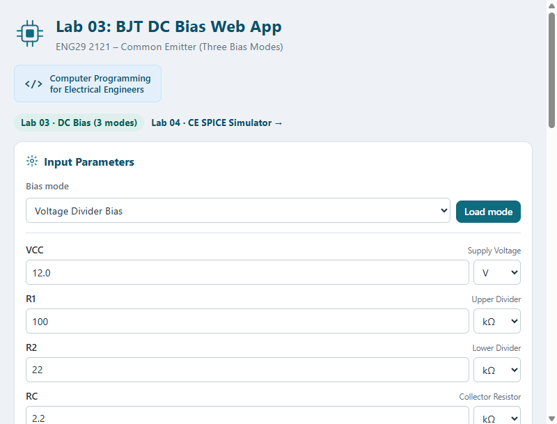 | B1 Divider — VB 1.94 V · VE 1.24 V · VC 9.29 V · VCE 8.05 V · IC 1.23 mA |
| 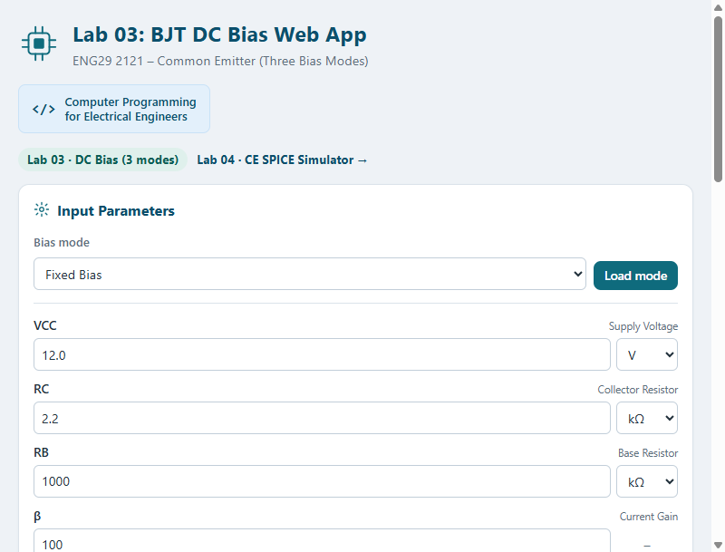 | B1 Fixed — VB 0.70 V · VE 0.00 V · VC 9.51 V · VCE 9.51 V · IC 1.13 mA |
| 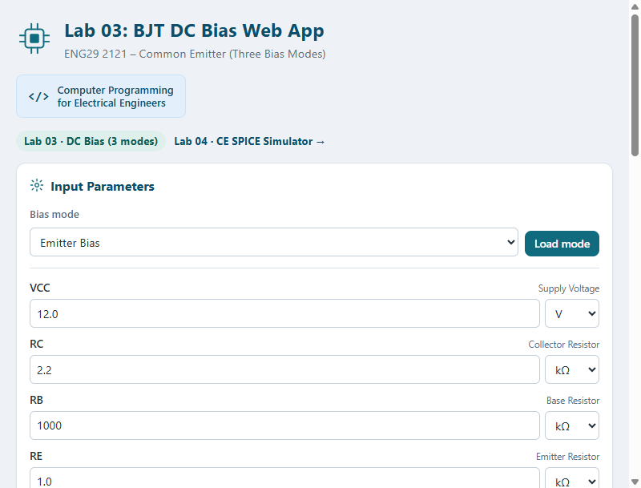 | B1 Emitter — VB 1.74 V · VE 1.04 V · VC 9.74 V · VCE 8.71 V · IC 1.03 mA |
| 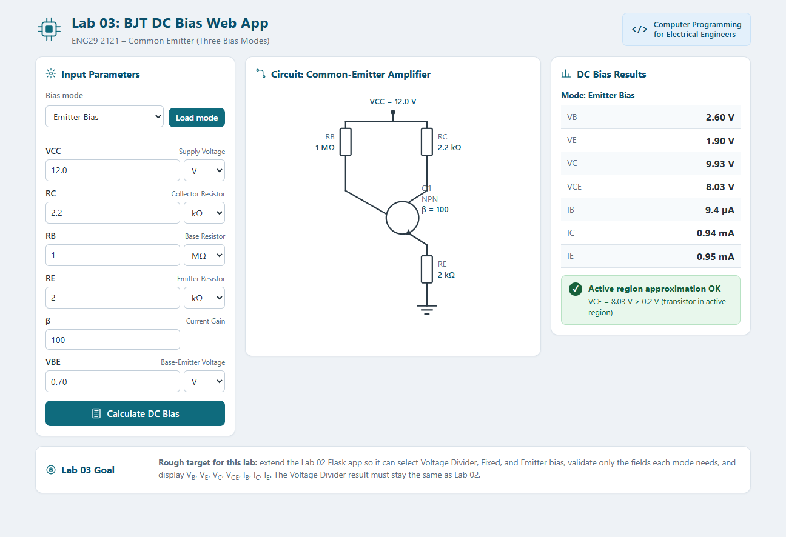 | A4 เปลี่ยน RE เป็น 2 kΩ — IC 0.94 mA · VCE 8.03 V |
| 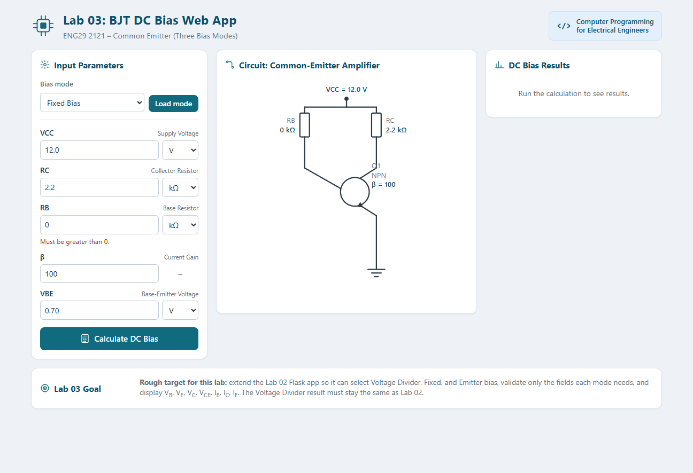 | A5 RB = 0 — `Must be greater than 0.` ไม่มีตารางผลค้าง |
| 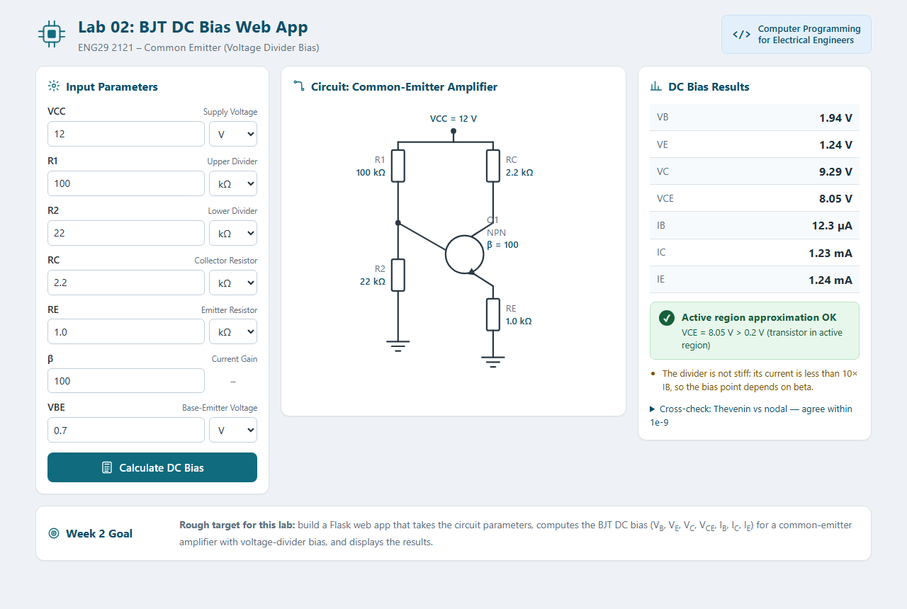 | Lab 03 active region example |
| 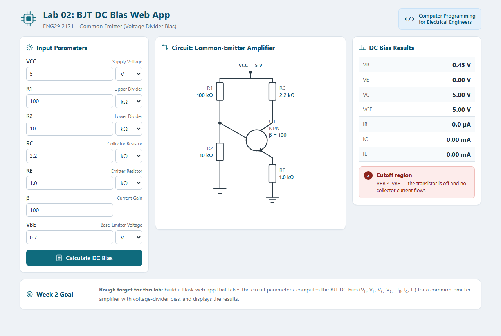 | Lab 03 cutoff region example |
| 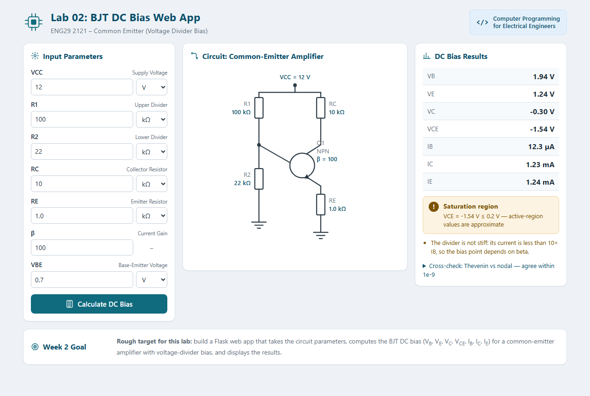 | Lab 03 saturation region example |

## Lab 04 SPICE / browser acceptance

| ภาพ | สิ่งที่เห็น |
|---|---|
| 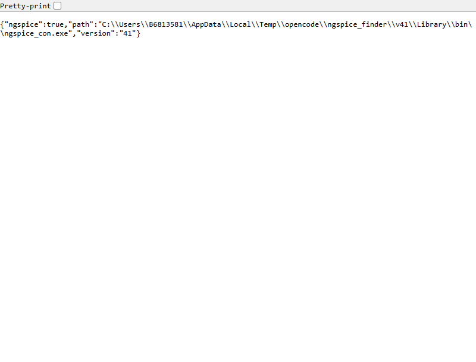 | `/health` → `ngspice:true`, `version:"41"`, `ngspice_con.exe` |
| 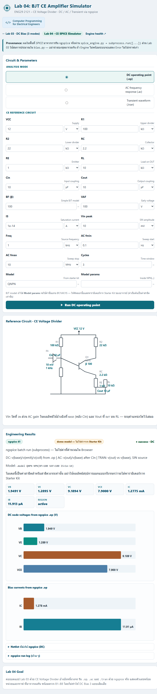 | B2 `.op` — VB 1.9491 V · VE 1.2895 V · VC 9.1894 V · VCE 7.9000 V · IC 1.2775 mA · IB 11.913 µA |
|  | B3 เปลี่ยน RE 1→2 kΩ — VB 2.0482 V · VE 1.4045 V · VCE 9.0646 V · IC 0.6959 mA |
| 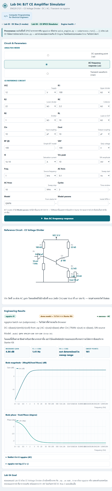 | B4 `.ac` — midband 4.86 dB · fL 1.41 Hz · fH `not determined in sweep range` · 161 points |
| 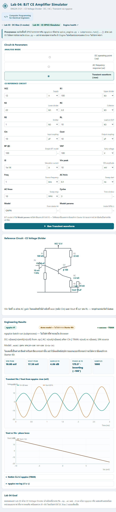 | B5 `.tran` 10 mV @ 1 kHz — Vin 10.00 mV · Vout 17.50 mV · 4.86 dB · 179.9° |
|  | B6 เปลี่ยนเป็น 20 mV @ 2 kHz — Vin 20.00 mV · Vout 35.00 mV · 180.0° |
| 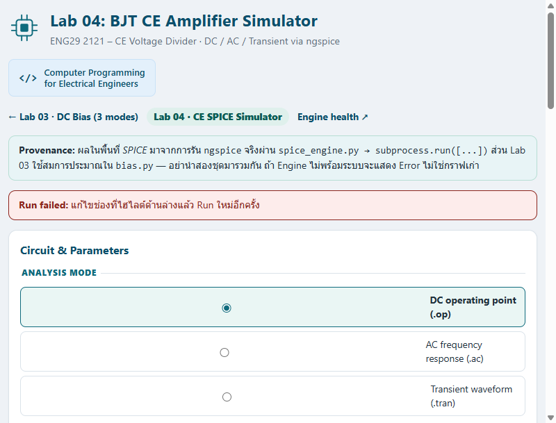 | B7 `RE=0` — `Run failed` + `Must be greater than 0.` ไม่มี result card |
| 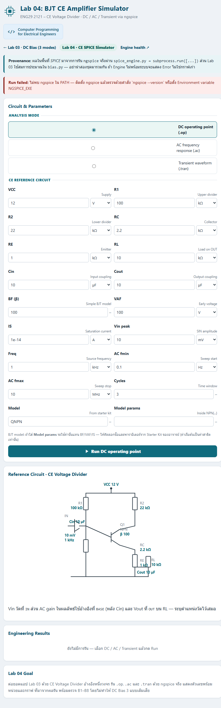 | B7 engine ไม่มี / narrow viewport — visible error, ไม่มีกราฟปลอม |

## Tests + UI evidence

| ภาพ | สิ่งที่เห็น |
|---|---|
| 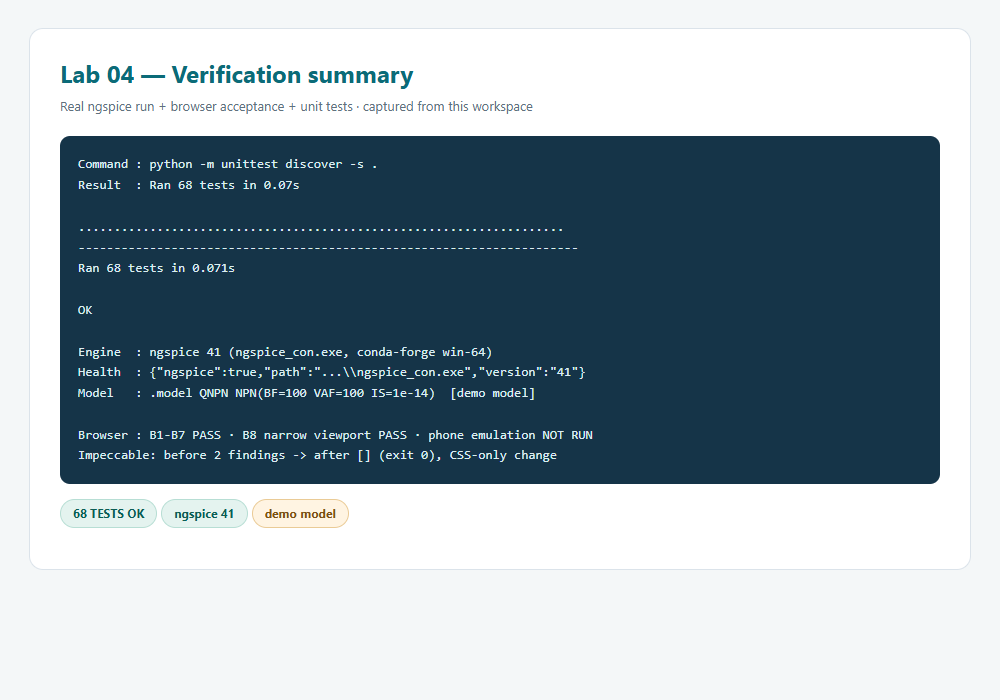 | `Ran 68 tests / OK` (49 Lab 03 + 19 Lab 04) |
| 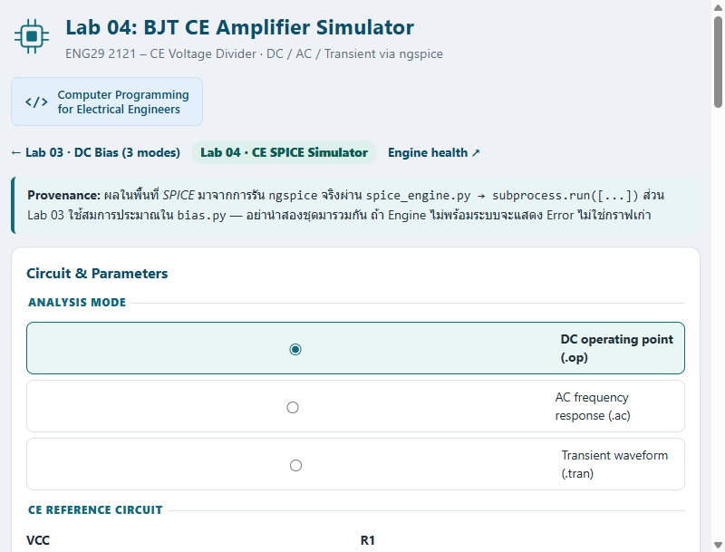 | Impeccable before — 2 findings |
| 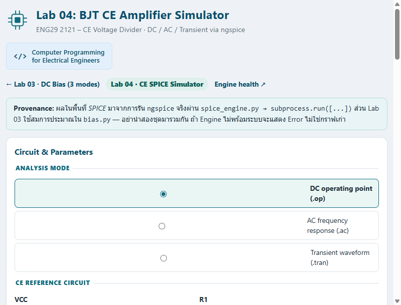 | Impeccable after — `[]`, exit 0, CSS-only, ผล DC ไม่เปลี่ยน |

หมายเหตุ: B8 phone emulation **NOT RUN** เพราะ browser tool มีแค่ viewport 800×609
—
ดูรายละเอียดใน [`validation.md`](validation.md) และ [`impeccable-audit.md`](impeccable-audit.md)
